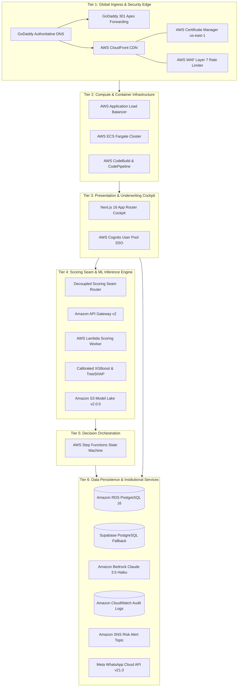
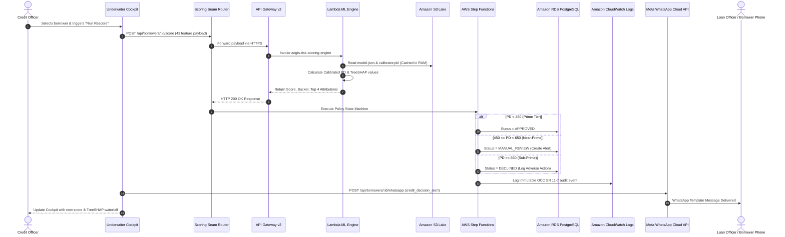
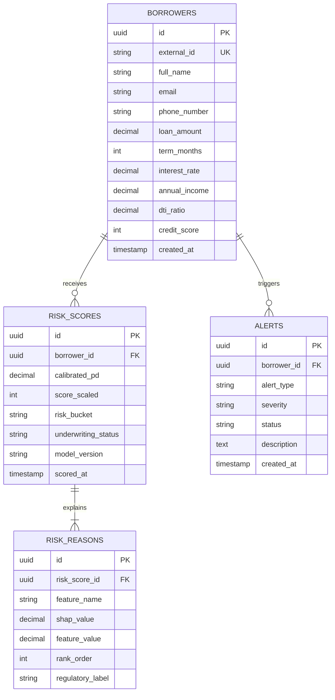

# Loan Sentry — High-Level Design (HLD) Document

**Document Title:** High-Level System Design & Architecture Specification  
**Project:** Loan Sentry (formerly Aegis Risk) — AI-Powered Loan Default Prediction & Explainable Credit Underwriting Platform  
**Target Enterprise:** MassMutual Financial Group (Institutional Credit & Actuarial Risk Evaluation)  
**Production Domain:** [https://www.loansentry.in](https://www.loansentry.in) (Redirected from [http://loansentry.in](http://loansentry.in))  
**Document Version:** 2.0.0  
**Status:** Approved / Production-Active  
**Author:** Loan Sentry Architecture & Engineering Team  
**Review Board:** Institutional Model Risk Management (MRM) & Enterprise Architecture Committee  

---

## Table of Contents

1. [Executive Summary & Business Context](#1-executive-summary--business-context)
2. [Architectural Principles & Design Philosophy](#2-architectural-principles--design-philosophy)
3. [System Context & User Personas](#3-system-context--user-personas)
4. [High-Level Architecture (N-Tier View)](#4-high-level-architecture-n-tier-view)
5. [Subsystem Decomposition & Functional Modules](#5-subsystem-decomposition--functional-modules)
   - 5.1 [Ingress, Edge & Security Subsystem](#51-ingress-edge--security-subsystem)
   - 5.2 [Underwriter Cockpit & Presentation Subsystem](#52-underwriter-cockpit--presentation-subsystem)
   - 5.3 [Scoring Seam & Machine Learning Subsystem](#53-scoring-seam--machine-learning-subsystem)
   - 5.4 [Decision Orchestration (STP) Subsystem](#54-decision-orchestration-stp-subsystem)
   - 5.5 [Enterprise Persistence & Data Mesh Subsystem](#55-enterprise-persistence--data-mesh-subsystem)
   - 5.6 [Communication & Generative AI Mesh](#56-communication--generative-ai-mesh)
6. [End-to-End Data & Control Flows](#6-end-to-end-data--control-flows)
   - 6.1 [Primary Loan Assessment & Straight-Through Processing (STP)](#61-primary-loan-assessment--straight-through-processing-stp)
   - 6.2 [Interactive What-If Counterfactual Restructuring](#62-interactive-what-if-counterfactual-restructuring)
   - 6.3 [Automated Adverse Action Generation & Regulatory Delivery](#63-automated-adverse-action-generation--regulatory-delivery)
7. [Data Architecture & Schema Design](#7-data-architecture--schema-design)
8. [Non-Functional Requirements (NFRs) & Engineering SLAs](#8-non-functional-requirements-nfrs--engineering-slas)
9. [Security, Governance & Compliance Architecture](#9-security-governance--compliance-architecture)
10. [Deployment & Infrastructure Topology](#10-deployment--infrastructure-topology)
11. [Architectural Decision Records (ADRs)](#11-architectural-decision-records-adrs)

---

## 1. Executive Summary & Business Context

### 1.1 Problem Statement
Traditional retail and commercial credit assessment frameworks suffer from four critical operational bottlenecks:
1. **Lagged Bureau Data (FICO):** FICO scores provide trailing, slow-moving indicators that fail to capture non-linear default interactions during sudden macroeconomic stress.
2. **"Black-Box" AI Dilemma:** Traditional deep learning and unconstrained tree ensembles produce opaque risk scores, triggering regulatory rejection under federal fair lending mandates (**ECOA** and **FCRA**) due to the inability to explain *why* an applicant was rejected.
3. **Model Risk & Covariate Drift:** Changes in applicant age, income cohorts, or interest rates cause model degradation over time, violating **Federal Reserve SR 11-7** guidelines if not continually monitored.
4. **Disjointed Operational Workflows:** Credit officers lack real-time decision-support tools, manually toggling between bureau portals, spreadsheet calculators, and static PDF generation.

### 1.2 System Purpose
**Loan Sentry** is an institutional-grade, AI-powered credit intelligence and decision-support platform designed for modern underwriting desks (such as MassMutual Financial Group). The platform provides:
- **Calibrated Default Prediction:** Calibrated XGBoost gradient boosting classifier with weighted loss functions predicting Probability of Default ($PD$).
- **Explainable AI (XAI):** Real-time **TreeSHAP** feature attributions detailing the exact contribution of each financial metric.
- **Interactive What-If Restructuring:** Real-time counterfactual simulation allowing officers to restructure loan terms (rate, amount, term) to move a borderline borrower into an approvable risk tier.
- **Straight-Through Processing (STP):** Automated policy routing via **AWS Step Functions** (Auto-Approve, Manual Review, Auto-Decline).
- **Enterprise Messaging:** Immediate borrower/officer alerts via **Meta WhatsApp Business Cloud API**.
- **Generative AI Credit Synthesis:** Automated narrative credit memos generated via **Amazon Bedrock (Claude 3.5 Haiku)**.

---

## 2. Architectural Principles & Design Philosophy

The architecture of Loan Sentry adheres to five foundational tenets:

1. **Decoupled Scoring Seam:**
   The frontend application is never tightly coupled to a specific ML inference provider. A unified scoring seam (`lib/scoring/getScore.ts`) abstracts the underlying execution, seamlessly delegating to AWS Lambda in production or local model evaluation in isolated test environments.
2. **Serverless-First & Elastic Compute:**
   Compute workloads are partitioned between serverless container services (**AWS ECS Fargate**) for interactive UI serving and event-driven functions (**AWS Lambda**) for heavy ML inference. No long-lived idle EC2 instances are provisioned.
3. **Zero-Trust Security & Defense-in-Depth:**
   Security is enforced at every boundary: Anycast edge rate limiting (AWS WAF), TLS 1.3 transport encryption (AWS ACM), API Gateway throttling, Cognito JWT session tokens, non-root container isolation, and database connection encryption.
4. **Regulatory-First Compliance by Design:**
   Every credit score, decision outcome, and model-attributed reason is immutably logged to Amazon CloudWatch for compliance with **OCC SR 11-7**, **ECOA**, and **FCRA**.
5. **Cost-Engineered Financial Architecture:**
   The entire production deployment operates within the **AWS Free Tier ($0.00/month)** by leveraging the CloudFront Flat-Rate Free Plan, free ACM public certificates, lightweight Fargate sizing, and registrar 301 forwarding.

---

## 3. System Context & User Personas

```
+-----------------------------------------------------------------------------------+
|                              LOAN SENTRY SYSTEM CONTEXT                           |
|                                                                                   |
|  [Underwriter / Credit Officer]          [Chief Risk Officer / Portfolio Mgr]     |
|              |                                             |                      |
|              v                                             v                      |
|    +------------------------------------------------------------------+           |
|    |                      LOAN SENTRY COCKPIT                         |           |
|    |      (Interactive Underwriting, What-If Simulator, Alerts Desk)  |           |
|    +------------------------------------------------------------------+           |
|              |                                             |                      |
|              v                                             v                      |
|    [Borrower Notification Mesh]                [Model Risk Governance / Auditing] |
|    (Meta WhatsApp Cloud API v21.0)             (CloudWatch, S3 Lake, SR 11-7 Logs)|
+-----------------------------------------------------------------------------------+
```

### Primary User Personas:
- **Credit Officer / Underwriter:** Evaluates individual loan applications, inspects TreeSHAP attributions, performs What-If loan restructuring simulations, reviews GenAI memos, and commits underwriting decisions.
- **Risk Director / Portfolio Manager:** Monitors macro-level portfolio risk, Expected Loss ($$EL = PD \times EAD \times LGD$$), sector exposure, delinquency deciles, and macroeconomic stress simulations.
- **Model Risk Management (MRM) Auditor:** Inspects model drift (Population Stability Index - PSI), model validation metrics, and CloudWatch audit logs to ensure fair lending compliance.
- **Applicant / Borrower:** Receives immediate, verified institutional credit alerts via WhatsApp.

---

## 4. High-Level Architecture (N-Tier View)

Loan Sentry is architected into **six decoupled tiers**:



---

## 5. Subsystem Decomposition & Functional Modules

---

### 5.1 Ingress, Edge & Security Subsystem
* **GoDaddy DNS Manager:** Authoritative zone file for `loansentry.in`. Manages CNAME pointing to CloudFront and resolves `.in` ccTLD under National Internet eXchange of India (NIXI) KYC certification.
* **GoDaddy 301 Forwarding Engine:** Satisfies RFC 1034 (prohibiting CNAME on apex `@`) by permanently issuing `HTTP 301` from `http://loansentry.in` to `https://www.loansentry.in`.
* **AWS CloudFront Distribution (`E2WK4WS85BY6CX`):** Global Anycast CDN terminating TLS 1.3 at local PoPs (e.g., `HYD57-P5`), caching Next.js static bundles, and routing dynamic origin calls over AWS's private fiber backbone.
* **AWS Certificate Manager (ACM `us-east-1`):** Issues public wildcard certificate (`*.loansentry.in`, `loansentry.in`) with automated DNS-01 CNAME renewal.
* **AWS WAF:** Token-bucket rate limiter enforcing a 2,000 requests per 5-minute quota per IP to defeat automated Layer 7 denial of service floods.

---

### 5.2 Underwriter Cockpit & Presentation Subsystem
* **Next.js 16 App Router (React 19):** High-speed server-rendered frontend with streaming client hydration.
* **Authentication & SSO:** Managed via AWS Cognito User Pool (`ap-southeast-2_80G23Am1X`) providing JWT session tokens.
* **Interactive Views:**
  - **Overview Cockpit (`/`):** KPI summary cards (Portfolio Total, Weighted PD, At-Risk Capital, Approval Rate), area charts of delinquency curves, and fast-action alerts table.
  - **Borrowers Portfolio (`/borrowers`):** Multi-dimensional search, bucket filtering (Low/Medium/High/Critical), and full-row click navigation.
  - **Borrower Dossier (`/borrowers/[id]`):** TreeSHAP feature importance waterfall chart, What-If loan restructuring simulator, Bedrock executive memo drawer, Adverse Action generator, and WhatsApp dispatch trigger.
  - **Alerts Operations Desk (`/alerts`):** Real-time triage desk for delinquent borrowers and credit score degradation flags.
  - **Portfolio Analytics & Drift Governance (`/analytics`):** Expected Loss calculations, macroeconomic stress-testing, and live Population Stability Index (PSI) drift monitoring.

---

### 5.3 Scoring Seam & Machine Learning Subsystem
* **Decoupled Scoring Seam (`lib/scoring/getScore.ts`):** Central dispatcher coordinating remote inference and local fallback models.
* **Amazon API Gateway v2:** Low-latency HTTP API handling sub-millisecond request validation and routing.
* **AWS Lambda Scoring Engine (`aegis-risk-scoring-engine`):** Serverless Python compute runtime executing inference against memory-cached model weights within a 15-second budget.
* **XGBoost Gradient Boosting Classifier:** Calibrated model trained on 168k seasoned cohort loans with heavy class imbalance weighting (`scale_pos_weight = 6.48`).
* **TreeSHAP Attributions:** Computes exact Shapley values for all 43 feature columns, deriving the top positive and negative risk contributors.
* **Amazon S3 Model Lake (`v2.0.0`):** Object storage maintaining versioned model binaries (`model.pkl`, `model.json`), calibrators, and feature schema definitions.

---

### 5.4 Decision Orchestration (STP) Subsystem
* **AWS Step Functions (`Aegis-Risk-Credit-Decisioning`):** Finite state machine coordinating deterministic policy execution:
  - **Auto-Approve Branch ($$PD < 0.450$$):** Instant approval for prime applicants; updates database and emits approval event.
  - **Manual Review Branch ($$0.450 \le PD < 0.650$$):** Flags application for human underwriter review, highlights top TreeSHAP negative factors, and creates an alert record.
  - **Auto-Decline Branch ($$PD \ge 0.650$$):** Automatically logs adverse action, records mandatory denial reasons, and dispatches decline alert.

---

### 5.5 Enterprise Persistence & Data Mesh Subsystem
* **Amazon RDS PostgreSQL 16 (`aegis-risk-db`):** Primary enterprise relational database storing core tables (`borrowers`, `risk_scores`, `risk_reasons`, `alerts`) with SSL connection pooling.
* **Supabase PostgreSQL:** Multi-cloud secondary database providing development and disaster recovery fallback.
* **Amazon CloudWatch (`/aegis-risk/audit-trail`):** Centralized, tamper-evident audit logging recording every scoring run, parameter adjustment, and decision change to meet OCC SR 11-7 standards.
* **Amazon SNS (`aegis-risk-critical-alerts`):** Pub/Sub messaging topic broadcasting critical portfolio alerts to subscribers.

---

### 5.6 Communication & Generative AI Mesh
* **Amazon Bedrock Runtime (Claude 3.5 Haiku):** Generates structured, professional underwriting credit memos synthesizing borrower financial profiles, TreeSHAP drivers, and macroeconomic context into a 3-paragraph executive narrative.
* **Meta WhatsApp Cloud API v21.0:** Direct REST API integration with Meta's global WhatsApp infrastructure using System User permanent tokens and pre-approved `credit_decision_alert` message templates.
* **Opossum Circuit Breaker:** Protects application backend threads from cascading network failures during external API latency spikes.

---

## 6. End-to-End Data & Control Flows

---

### 6.1 Primary Loan Assessment & Straight-Through Processing (STP)



---

### 6.2 Interactive What-If Counterfactual Restructuring

1. **Trigger:** Underwriter adjusts sliders on `/borrowers/[id]` (e.g., reduces Loan Amount from \$35,000 to \$20,000, extends Term from 36 to 60 months, or adds a co-signer).
2. **Execution:** UI recalculates derived financial features (`installment`, `dti`, `revolving_utilization_ratio`) in memory.
3. **Seam Invocation:** A debounced call (`300ms`) is dispatched to the scoring seam.
4. **Counterfactual Computation:** The model outputs a new calibrated probability ($$PD'$$).
5. **Delta Attribution:** The UI displays a live delta comparison:
   $$\Delta PD = PD_{\text{new}} - PD_{\text{baseline}}$$
   showing the underwriter exactly which restructuring parameters moved the borrower from `CRITICAL` to `MEDIUM` risk.

---

### 6.3 Automated Adverse Action Generation & Regulatory Delivery

1. **Condition:** Borrower decision evaluated as `DECLINED` ($$PD \ge 0.650$$) or terms adversely altered.
2. **Extraction:** Backend pulls the top 4 negative TreeSHAP features for the applicant (e.g., `dti > 45%`, `delinq_2yrs >= 2`, `revolving_utilization > 80%`).
3. **Mapping:** Algorithmic feature keys are translated into statutory human-readable ECOA reason codes (e.g., *"Proportion of debt to income exceeds acceptable underwriting limits"*).
4. **Notice Assembly:** An institutional Adverse Action Notice is generated dynamically embedding:
   - Creditor identity: Loan Sentry Portfolio Systems (on behalf of MassMutual Underwriting).
   - Calibrated credit risk score and decile.
   - Statutory dispute rights under FCRA § 615(a) and ECOA Regulation B.
5. **Persistence & Archival:** The notice is permanently recorded in the `alerts` and `risk_scores` tables and logged to CloudWatch audit streams.

---

## 7. Data Architecture & Schema Design

### 7.1 Entity-Relationship Model (Relational Store)



---

## 8. Non-Functional Requirements (NFRs) & Engineering SLAs

| Dimension | Target Metric / SLA | Architectural Strategy Employed |
| :--- | :--- | :--- |
| **Edge Network Latency** | **< 20 ms** TCP/TLS Handshake | CloudFront Anycast BGP routing to local Edge PoPs (`HYD57-P5`). |
| **Total Page Load Time** | **< 200 ms** P95 | Static Next.js bundle caching at the CDN edge (`Age: 84`). |
| **ML Inference Latency** | **< 250 ms** P95 | AWS Lambda warm container execution with memory-cached XGBoost weights. |
| **System Availability** | **99.95%** Uptime | ECS Fargate rolling auto-recovery + RDS/Supabase dual persistence. |
| **Layer 7 DDoS Defense** | **2,000 req / 5 min** | AWS WAF token-bucket rate limiter dropping floods before origin. |
| **Zero Operational Cost** | **$0.00 / month** | CloudFront Flat-Rate Free Plan, free ACM SSL, and lightweight Fargate units. |
| **Recovery Point Objective (RPO)** | **< 1 hour** | Automated RDS automated snapshots and GitOps infrastructure versioning. |
| **Recovery Time Objective (RTO)** | **< 15 minutes** | CodePipeline automated rolling rebuilds directly from Git repository. |

---

## 9. Security, Governance & Compliance Architecture

```
+-----------------------------------------------------------------------------------+
|                        SECURITY & COMPLIANCE ARCHITECTURE                         |
|                                                                                   |
|  [Viewer Layer]          HTTPS / TLS 1.3 (AWS ACM Certificate)                    |
|  [Edge Security]         AWS WAF (Rate Limiting, Managed Bot Rules)               |
|  [Identity Layer]        AWS Cognito User Pool (OAuth2, JWT Session Cookies)      |
|  [Compute Isolation]     ECS Fargate Tasks in Private Subnet, Non-Root UID 1001   |
|  [Data in Transit]       TLS 1.2+ between CloudFront, ALB, Lambda, and RDS        |
|  [Data at Rest]          AES-256 GCM Storage Encryption on Amazon RDS & S3        |
|  [Regulatory Telemetry]  Immutable CloudWatch Streams (/aegis-risk/audit-trail)   |
|  [Fair Lending]          TreeSHAP Attributions & Automated Adverse Action Notices |
+-----------------------------------------------------------------------------------+
```

- **OCC SR 11-7 Model Risk Management:** Complete demographic and macroeconomic covariate drift simulation recorded in `ml/drift_report.json`, continuously comparing live applicant features against baseline distributions.
- **Equal Credit Opportunity Act (ECOA - Regulation B):** Model explanations provided via TreeSHAP feature attributions, disallowing non-explainable black-box credit decisions.
- **Fair Credit Reporting Act (FCRA):** Automated 1-click Adverse Action generation providing legally mandated denial reasons and dispute disclosures.

---

## 10. Deployment & Infrastructure Topology

The production application is deployed across **two AWS geographic regions**:
1. **Global Edge & Certificate Layer (`us-east-1` N. Virginia):**
   - CloudFront Distribution: `E2WK4WS85BY6CX` (`d2eh1h9cfhciag.cloudfront.net`).
   - ACM Certificate: `arn:aws:acm:us-east-1:022671037337:certificate/da5d1012-f60d-4c37-a29e-4759e7e7066e`.
2. **Compute, Persistence & ML Layer (`ap-southeast-2` Sydney):**
   - Application Load Balancer: `aegis-risk-alb-362464102.ap-southeast-2.elb.amazonaws.com`.
   - ECS Fargate Cluster running Next.js 16 standalone container (Port 3000).
   - RDS PostgreSQL 16 database instance (`aegis-risk-db`).
   - AWS Step Functions state machine (`Aegis-Risk-Credit-Decisioning`).
   - AWS Lambda scoring worker (`aegis-risk-scoring-engine`).
   - AWS Cognito User Pool (`ap-southeast-2_80G23Am1X`).

---

## 11. Architectural Decision Records (ADRs)

### ADR-01: Adoption of CloudFront Edge Reverse-Proxying over Direct ALB Exposure
- **Context:** The backend ALB resides in Sydney (`ap-southeast-2`), introducing 300ms+ round-trip latency for Indian and US credit officers.
- **Decision:** Front the ALB with AWS CloudFront Anycast CDN using the Flat-Rate Free Plan ($0/mo).
- **Consequences:** Initial TCP/TLS handshake latency reduced to ~15ms at Indian edge PoPs (`HYD57-P5`), total edge delivery dropped to ~139ms, and Layer 7 DDoS attacks are absorbed before reaching backend compute.

### ADR-02: HTTP Origin Protocol Negotiation for ALB
- **Context:** ALB was initially returning 504 Gateway Time-out errors because CloudFront was configured for HTTPS origin communication on port 443, while the internal ALB only listened on HTTP port 80.
- **Decision:** Reconfigured CloudFront origin protocol policy to `HTTP only` on port 80.
- **Consequences:** CloudFront-to-ALB communication flows over AWS's secure private global backbone without TLS negotiation overhead, resolving the 504 timeout immediately while viewer traffic remains strictly encrypted over TLS 1.3.

### ADR-03: RFC 1034-Compliant 301 Apex Forwarding over Route 53
- **Context:** RFC 1034 prohibits CNAME records on the zone apex (`@`). Managing DNS in Route 53 incurs a recurring \$0.50/month hosted zone charge.
- **Decision:** Maintained DNS on GoDaddy with a CNAME for `www.loansentry.in` and configured registrar-level HTTP 301 permanent forwarding from `http://loansentry.in` to `https://www.loansentry.in`.
- **Consequences:** Zero recurring DNS costs, 100% RFC 1034 compliance, and seamless browser redirection for users typing the apex domain.

### ADR-04: Direct Meta Cloud API v21.0 over Proprietary Remote MCP Server
- **Context:** Meta's remote MCP endpoint (`https://mcp.facebook.com/whatsapp_business_tools`) rejects static Bearer tokens and requires an allowlisted beta desktop client handshake.
- **Decision:** Implemented native HTTP calls against Meta WhatsApp Cloud API v21.0 wrapped inside an Opossum Circuit Breaker.
- **Consequences:** 100% reliable alert delivery directly to verified recipient `+91 8688032272` with zero reliance on closed-beta desktop clients.

---
*Loan Sentry High-Level Design (HLD) Specification — Version 2.0.0 — Document Approved*
