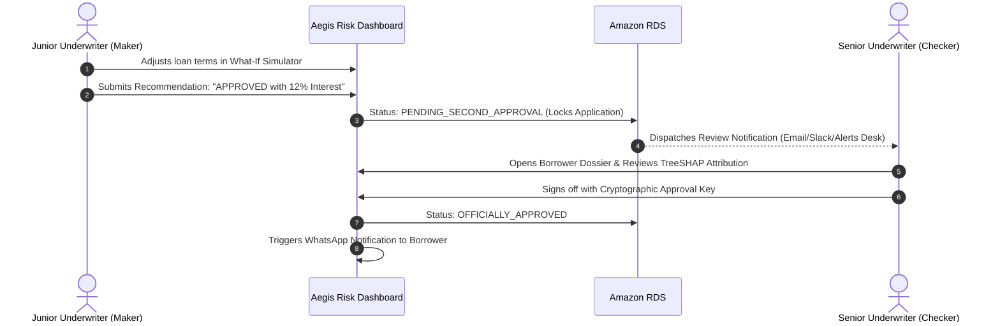

# Aegis Risk — Production Engineering Roadmap & Institutional Architecture Concepts

**System Target:** Aegis Risk Portfolio Intelligence & Credit Decisioning Platform  
**Enterprise Standard:** Tier-1 Institutional Banking & Actuarial Governance (MassMutual, OCC SR 11-7, FCRA, ECOA, SOC 2)  
**Document Classification:** Production Maturity & Engineering Roadmap Specification  

---

## Executive Overview

To advance **Aegis Risk** from an operational prototype to a **Tier-1 institutional financial platform** (matching the rigorous engineering and regulatory standards of financial giants like MassMutual, JPMorgan, and Capital One), several mission-critical production capabilities must be layered into the system.

This document serves as the comprehensive architectural roadmap covering:
1. **Edge & Application Security (Defense-in-Depth)**
2. **Observability, SRE & Telemetry (Site Reliability Engineering)**
3. **Database Scalability & Micro-Caching**
4. **Institutional Underwriting & FinTech Governance**
5. **DevOps, CI/CD & Infrastructure as Code (IaC)**
6. **Prioritized Implementation Roadmap & Effort Matrix**

---

## 1. Edge & Application Security (Defense-in-Depth)

---

### 1.1 Strict HTTP Security Headers & Content Security Policy (CSP)

#### The Concept
HTTP security headers instruct modern web browsers to restrict script execution, resource loading, and framing boundaries, mitigating major attack vectors such as Cross-Site Scripting (XSS), Clickjacking, and MIME type sniffing.

#### Regulatory & Banking Rationale
Banking platforms that process credit assessments, sensitive PII, and financial authorizations are subject to strict compliance audits (**SOC 2 Type II**, **ISO/IEC 27001**, **FFIEC**, and **OWASP Top 10**). Missing or misconfigured security headers will trigger immediate critical findings during automated penetration tests.

#### Required Security Header Suite
- **`Strict-Transport-Security` (HSTS):** Enforces HTTPS connections and disallows any HTTP downgrade.
  ```http
  Strict-Transport-Security: max-age=63072000; includeSubDomains; preload
  ```
- **`X-Frame-Options`:** Prevents the underwriting dashboard from being rendered inside an `<iframe>`, neutralizing UI clickjacking attacks.
  ```http
  X-Frame-Options: DENY
  ```
- **`X-Content-Type-Options`:** Stops browsers from attempting to guess the MIME type of a response, blocking script execution disguised as images.
  ```http
  X-Content-Type-Options: nosniff
  ```
- **`Referrer-Policy`:** Prevents leaking sensitive URL paths (such as loan application IDs) when users click outbound links.
  ```http
  Referrer-Policy: strict-origin-when-cross-origin
  ```
- **`Permissions-Policy`:** Explicitly disables unused browser hardware APIs (microphone, camera, geolocation, USB).
  ```http
  Permissions-Policy: camera=(), microphone=(), geolocation=(), payment=()
  ```
- **`Content-Security-Policy` (CSP):** A whitelist defining the exact origins allowed to load scripts, styles, fonts, and network connections:
  ```http
  Content-Security-Policy: default-src 'self'; script-src 'self' 'unsafe-inline' 'unsafe-eval'; connect-src 'self' https://*.amazonaws.com https://graph.facebook.com; img-src 'self' data: https:; style-src 'self' 'unsafe-inline'; font-src 'self' data:; frame-ancestors 'none';
  ```

#### Implementation in `next.config.mjs`
```javascript
/** @type {import('next').NextConfig} */
const securityHeaders = [
  { key: 'Strict-Transport-Security', value: 'max-age=63072000; includeSubDomains; preload' },
  { key: 'X-Frame-Options', value: 'DENY' },
  { key: 'X-Content-Type-Options', value: 'nosniff' },
  { key: 'Referrer-Policy', value: 'strict-origin-when-cross-origin' },
  { key: 'Permissions-Policy', value: 'camera=(), microphone=(), geolocation=()' },
  {
    key: 'Content-Security-Policy',
    value: "default-src 'self'; script-src 'self' 'unsafe-inline' 'unsafe-eval'; connect-src 'self' https://*.amazonaws.com https://graph.facebook.com; img-src 'self' data: https:; style-src 'self' 'unsafe-inline';",
  },
]

const nextConfig = {
  async headers() {
    return [
      {
        source: '/(.*)',
        headers: securityHeaders,
      },
    ]
  },
  ...(process.env.BUILD_STANDALONE === 'true' || process.env.DOCKER_BUILD === '1'
    ? { output: 'standalone' }
    : {}),
}

export default nextConfig
```

---

### 1.2 Granular Role-Based Access Control (RBAC) & Next.js Middleware Guards

#### The Concept
Moving beyond binary authentication (logged in vs. logged out) to enforce granular role hierarchies:
1. `RISK_ANALYST`: Read-only access to portfolio analytics and sandbox What-If loan restructuring simulations.
2. `CREDIT_OFFICER`: Authority to input financial information, initiate rescores, and draft underwriting memos.
3. `SENIOR_UNDERWRITER`: Authority to officially commit `APPROVED` or `DECLINED` loan decisions, override model recommendations, and trigger automated WhatsApp alerts.
4. `COMPLIANCE_AUDITOR`: Read-only access to audit logs, model governance cards, drift statistics, and adverse action records.

#### Architectural Flow in Next.js `middleware.ts`
```
[Incoming Request: POST /api/borrowers/:id/decision]
         |
         v
[Next.js Edge Middleware]
         |
         +---> (1) Extract & Verify Cognito JWT Bearer / Session Cookie
         |
         +---> (2) Inspect Claim: `cognito:groups`
         |
         |---> If role != 'SENIOR_UNDERWRITER' -> Return 403 Forbidden (RBAC Guard)
         |
         +---> (3) Allow pass-through to API Handler with User Context Header
```

---

### 1.3 Sensitive PII Masking & Column-Level KMS Encryption

#### The Concept
Ensuring borrower Personally Identifiable Information (Tax IDs, Social Security Numbers, full home addresses, and bank account numbers) is masked on general officer screens and cryptographically secured in storage.

#### Regulatory Rationale
Under the **Gramm-Leach-Bliley Act (GLBA)** and California Financial Information Privacy Act, unmasked PII exposure creates immediate liability in the event of screen capture, shoulder-surfing, or insider threats.

#### Implementation Pattern
- **UI Masking:** `SSN: ***-**-4891`, `Phone: +91 86880-XXXXX`.
- **At-Rest Encryption:** Utilizing **AWS KMS (Key Management Service)** Customer Managed Keys (CMK) with AES-256 GCM envelope encryption for sensitive database columns (`borrowers.tax_id`, `borrowers.ssn_hash`).

---

## 2. Observability, SRE & Telemetry (Site Reliability Engineering)

---

### 2.1 Real User Monitoring (RUM) & Client Error Tracking (Sentry)

#### The Problem in Production
In modern Single Page Applications (Next.js/React), fatal rendering exceptions, unhandled Promise rejections, or hydration mismatches execute entirely inside the user's browser runtime. Without dedicated RUM tooling, engineers remain unaware of critical bugs until an underwriter submits a support ticket.

#### The Architecture
- Integrate **Sentry** or **AWS CloudWatch RUM** via lightweight SDK.
- Automatically capture:
  - Complete JavaScript stack traces with mapped source maps.
  - User interaction breadcrumbs leading up to the error (clicks, route changes).
  - Browser engine, OS version, network latency, and memory footprint.
  - Release tagging tied to the exact Git commit SHA.

---

### 2.2 Distributed Tracing & Correlation IDs (`X-Correlation-ID`)

#### The Concept
Every user interaction initiates a distributed journey across multiple autonomous microservices:
$$\text{Browser} \longrightarrow \text{CloudFront} \longrightarrow \text{ALB} \longrightarrow \text{Next.js} \longrightarrow \text{PostgreSQL} \longrightarrow \text{Bedrock Claude} \longrightarrow \text{WhatsApp API}$$

#### Implementation
1. The CloudFront edge or Next.js middleware assigns a unique UUID:
   ```http
   X-Correlation-ID: a8f4c2e1-7b09-4321-9e12-38501234abcd
   ```
2. The ID is injected into every downstream HTTP request, database query comment, CloudWatch log record, and Bedrock invocation.
3. When debugging a slow request or failed transaction, searching for that single `correlation_id` across all CloudWatch log groups aggregates the entire distributed lifecycle.

---

### 2.3 Synthetic Canary Heartbeats & Uptime Monitoring

#### The Concept
Edge caching (CloudFront) can return `HTTP 200 OK` for cached static assets even if the database is completely down.
An independent synthetic canary (AWS Route 53 Health Checks, BetterStack, or Datadog) executes a continuous probe every 60 seconds against:
```http
GET https://www.loansentry.in/api/health?ready=true
```
- Performs a live `SELECT 1` on Amazon RDS PostgreSQL.
- Verifies filesystem integrity of `ml/model.json`.
- If either subsystem reports failure or exceeds a 1,500ms latency threshold, the probe immediately issues a `503 Service Unavailable` and triggers automated SMS/Slack alerts to the on-call engineering roster.

---

## 3. Database Scalability & Micro-Caching

---

### 3.1 AWS RDS Proxy (Connection Pool Resiliency)

```
[Serverless Compute / Concurrent Next.js Workers]
     |   |   |   |   |   (Hundreds of Transient Connections)
     v   v   v   v   v
+----------------------------------------------------+
|                  AWS RDS PROXY                     |
|  - Connection Multiplexing                         |
|  - Automatic Warm Connection Reuse                 |
|  - Transparent Failover Handling                   |
+----------------------------------------------------+
                         |
                         v (Maintains 10-20 Persistent Connections)
             [Amazon RDS PostgreSQL 16]
```

#### Why it is Mandatory for Scale
Each direct PostgreSQL connection consumes ~10 MB of RAM on the database server. Small RDS instances cap maximum connections at ~100.
Under sudden traffic surges (e.g., end-of-month batch underwriting), serverless workers can exhaust the connection pool, resulting in fatal `FATAL: remaining connection slots are reserved` errors. RDS Proxy multiplexes hundreds of frontend connections over a small, persistent pool of database connections.

---

### 3.2 Distributed In-Memory Caching (Redis / AWS ElastiCache)

#### The Problem
High-level analytical queries on the `/analytics` dashboard compute complex aggregations:
- Portfolio Expected Loss ($$EL = PD \times EAD \times LGD$$).
- Macroeconomic index shifts.
- Cross-sectional demographic distributions across hundreds of thousands of loan records.

#### The Solution
Layer **Redis (AWS ElastiCache)** with a cache-aside pattern:
1. Check Redis for key `portfolio:expected_loss:summary`.
2. On cache hit: Return payload in **< 5 ms**.
3. On cache miss: Execute SQL aggregation query, store result in Redis with a 300-second (5-minute) TTL, and return payload.

---

## 4. Institutional Underwriting & FinTech Governance

---

### 4.1 "Maker-Checker" Dual Approval Workflow

#### The Principle
Under commercial underwriting best practices (and statutory banking internal controls), no individual credit officer can unilaterally approve high-principal or borderline-risk loans.



---

### 4.2 Automated Adverse Action Notice PDF Generator (FCRA / ECOA Compliance)

#### Federal Mandate
Under the **Equal Credit Opportunity Act (ECOA)** (12 CFR Part 1002 - Regulation B) and the **Fair Credit Reporting Act (FCRA)** (15 U.S.C. § 1681m), whenever a credit application is denied or terms are unfavorably altered, the creditor **must provide a written Adverse Action Notice within 30 days**.

#### Notice Requirements Built Into Aegis Risk:
1. **Principal Reasons for Denial:** Regulation B requires disclosing the top 4 principal reasons influencing the adverse decision. These are dynamically extracted from our **TreeSHAP negative attributions** (e.g., `Debt-to-Income Ratio Exceeds Threshold`, `High Revolving Utilization`, `Delinquency in Past 24 Months`).
2. **Credit Agency Disclosure:** Identity of the credit reporting agency utilized.
3. **Statutory Statement of Rights:** Standard statutory disclosures regarding the applicant's right to obtain a free credit report within 60 days and dispute inaccuracies.
4. **Implementation:** A 1-click **"Export Adverse Action PDF"** button generated on-the-fly using `@react-pdf/renderer` directly within the browser or via backend serverless PDF compilation.

---

### 4.3 Real-Time Population Stability Index (PSI) Drift Alerts

#### Mathematical Formulation
The Population Stability Index measures the shift between the baseline training distribution ($B$) and the current production inference distribution ($P$):

$$\text{PSI} = \sum_{k=1}^{K} \left( P_k - B_k \right) \times \ln\left(\frac{P_k}{B_k}\right)$$

Where $K$ represents the distribution bins of a feature (e.g., credit score deciles, annual income bands).

#### Threshold Interpretation:
- **$\text{PSI} < 0.10$:** Negligible Shift — No action required.
- **$0.10 \le \text{PSI} < 0.25$:** Moderate Shift — Model Risk Management (MRM) monitoring flag.
- **$\text{PSI} \ge 0.25$:** Significant Shift — **Model Degraded**. Triggers automatic alert to retrain the XGBoost weights and recalibrate Platt scaling parameters.

---

## 5. DevOps, CI/CD & Infrastructure as Code (IaC)

---

### 5.1 Infrastructure as Code (Terraform / AWS CDK)

#### The Problem with "Click-Ops"
Configuring CloudFront distributions, ACM certificates, WAF rate-limiting rules, ALB listeners, and Route 53 records manually in the AWS Console is prone to human error and cannot be reliably reproduced in a secondary disaster recovery region.

#### The Solution
Capture the entire AWS architecture in declarative **Terraform (`.tf`)** modules:
- `modules/cloudfront`: CloudFront distribution, cache policies, and WAF associations.
- `modules/acm`: Multi-region certificate issuance and DNS challenge verification.
- `modules/ecs`: Fargate cluster, task definitions, auto-scaling policies, and security groups.
- `modules/rds`: PostgreSQL parameter groups, storage autoscaling, and RDS Proxy.

---

### 5.2 Zero-Downtime Blue/Green Deployments

#### The Concept
When deploying a new Next.js Docker container:
1. ECS launches the new task revision alongside the existing task.
2. The ALB registers the new container to a "Green" target group and runs continuous health checks against `/api/health`.
3. Once 3 consecutive health checks return `200 OK`, the ALB shifts incoming HTTP requests incrementally (e.g., 10% ➔ 50% ➔ 100%).
4. If the new container experiences elevated 5xx error rates, traffic immediately snaps back to "Blue" with zero downtime or user disruption.

---

## 6. Prioritized Implementation Roadmap & Effort Matrix

| Phase | Milestone | Concepts Included | Estimated Effort | Impact Level |
| :---: | :--- | :--- | :---: | :---: |
| **Phase 1** | **Edge Hardening & Compliance** | Strict HTTP Security Headers, Content Security Policy (CSP), and Sensitive PII Masking | 1 Day | 🔴 **Critical** |
| **Phase 2** | **Production Observability** | Sentry Client Error Tracking, Correlation IDs (`X-Correlation-ID`), and External Synthetic Canary Probes | 1 Day | 🔴 **Critical** |
| **Phase 3** | **Regulatory Underwriting** | Automated Adverse Action Notice (PDF Export) and Maker-Checker Dual Approval Workflow | 2–3 Days | 🟡 **High** |
| **Phase 4** | **Data & Scale Resiliency** | AWS RDS Proxy connection pooling and Redis caching for portfolio aggregations | 2 Days | 🟡 **High** |
| **Phase 5** | **Automated Model Governance** | Live PSI drift calculation cron and automated retraining triggers (OCC SR 11-7) | 3 Days | 🔵 **Medium** |
| **Phase 6** | **DevOps & IaC Automation** | Terraform codification of all AWS resources and Blue/Green ECS pipeline | 3–4 Days | 🔵 **Medium** |

---

*Aegis Risk Production Roadmap — Document Version 1.0.0 — Authored November 2026*
