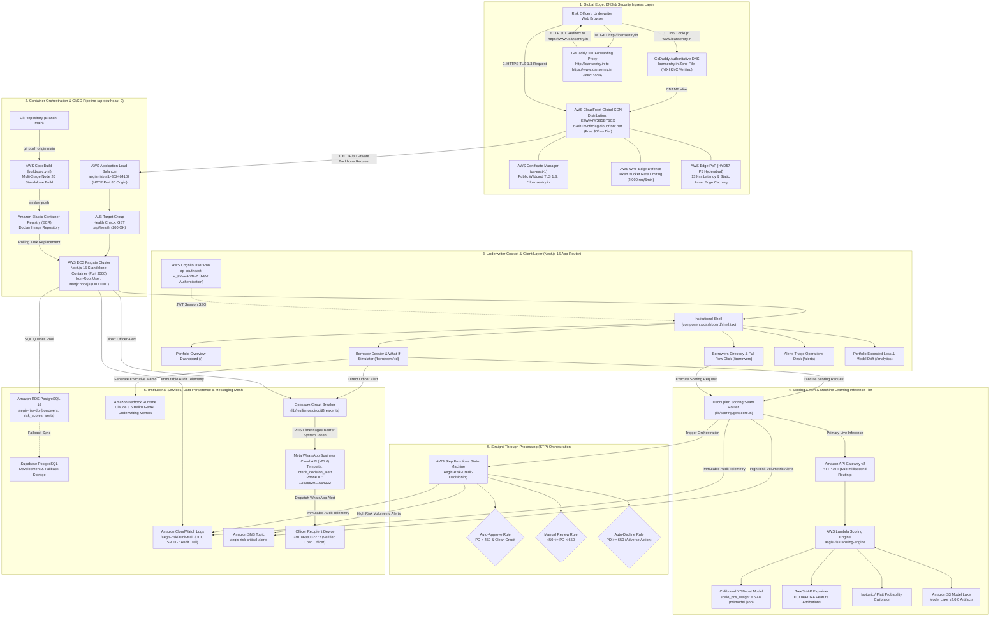

# Loan Sentry — Complete End-to-End System Architecture Topology

**System Name:** Loan Sentry (formerly Aegis Risk)  
**Enterprise Target:** MassMutual Financial Group (Institutional Credit Risk & Default Prediction)  
**Production Domain:** [https://www.loansentry.in](https://www.loansentry.in) (Apex: [http://loansentry.in](http://loansentry.in))  
**Cloud Providers:** Amazon Web Services (AWS Multi-Region: `us-east-1` & `ap-southeast-2`) + Meta Cloud Platform  
**Document Classification:** Master Architectural Specification & Infrastructure Topology  

---

## 1. Master System Architecture Diagram

---

## 2. Comprehensive Layer-by-Layer Inventory

### Layer 1: Global Edge, DNS & Security Ingress Layer
| Component | Provider / Technology | Specific Resource / Configuration | Role in System |
| :--- | :--- | :--- | :--- |
| **Domain Registrar & DNS** | GoDaddy | `loansentry.in` Zone File | Holds authoritative DNS records; NIXI digital KYC clearance completed. |
| **Apex Forwarding Proxy** | GoDaddy Forwarding Engine | `http://loansentry.in` ➔ `https://www.loansentry.in` | Issues an HTTP 301 Permanent Redirect to satisfy RFC 1034 apex CNAME constraints. |
| **Global Anycast CDN** | AWS CloudFront | Distribution: `E2WK4WS85BY6CX` Domain: `d2eh1h9cfhciag.cloudfront.net` | Terminates viewer TLS 1.3 globally, caches Next.js static assets, provides Free Flat-Rate Tier ($0/mo). |
| **SSL / TLS Certificate** | AWS Certificate Manager (ACM) | Region: `us-east-1` (N. Virginia) ARN: `da5d1012-f60d-4c37-a29e-4759e7e7066e` | Public wildcard certificate covering `loansentry.in` and `*.loansentry.in`. |
| **Layer 7 Edge Defense** | AWS WAF | CloudFront Managed WebACL | Token-bucket rate limiting (2,000 requests / 5 minutes) and automated DDoS shield. |
| **Edge Cache PoP** | AWS CloudFront Edge PoP | `HYD57-P5` (Hyderabad, India) | Delivers sub-15ms edge TCP/TLS handshakes and ~139ms total page delivery in India. |

---

### Layer 2: Container Orchestration & CI/CD Pipeline (`ap-southeast-2`)
| Component | Provider / Technology | Specific Resource / Configuration | Role in System |
| :--- | :--- | :--- | :--- |
| **Layer 7 Load Balancer** | AWS Application Load Balancer | `aegis-risk-alb-362464102.ap-southeast-2.elb.amazonaws.com` | Reverse proxy receiving HTTP port 80 traffic from CloudFront; path-based routing. |
| **Target Group** | AWS ALB Target Group | Port 3000 / Protocol: HTTP | Monitors backend container availability via `GET /api/health` probes every 30s. |
| **Serverless Compute** | AWS ECS Fargate | Task Definition: 0.25 vCPU, 512 MB RAM | Executes containerized Next.js 16 standalone server without provisioning EC2 VMs. |
| **Container Image** | Docker / Node.js 20 Alpine | `Dockerfile` (Multi-stage build) | Ultra-lightweight standalone build (~180 MB) running as non-root user `nextjs:nodejs`. |
| **Container Registry** | Amazon ECR | Private Repository | Stores immutable versioned production Docker image tags. |
| **CI/CD Build Runner** | AWS CodeBuild / CodePipeline | `buildspec.yml` | Automatically compiles Docker image and triggers zero-downtime rolling task replacements on Git push. |

---

### Layer 3: Underwriter Cockpit & Client Presentation Tier
| Component | Provider / Technology | Specific Resource / Configuration | Role in System |
| :--- | :--- | :--- | :--- |
| **User Directory & SSO** | AWS Cognito | User Pool: `ap-southeast-2_80G23Am1X` Client ID: `74120ugqosjjpmup4utltl1oqf` | Underwriter authentication, MFA, and JWT session token generation. |
| **Web Framework** | Next.js 16 (React 19) | App Router, Server Components & Client Hooks | High-performance institutional underwriting dashboard. |
| **UI Design System** | Tailwind CSS + Lucide Icons | Dark/Light Mode Theme Provider | Polished banking dashboard styling with responsive mobile drawer navigation. |
| **Data Visualizations** | Recharts (SVG Charts) | AreaCharts, BarCharts, Custom Gauges | Interactive default risk deciles, delinquency distributions, and score breakdowns. |
| **What-If Loan Simulator** | React State + Seam APIs | `/borrowers/[id]` Cockpit | Real-time counterfactual credit restructuring (adjusting loan amount, term, rate, DTI). |
| **Audit CSV Export** | Client-Side CSV Serializer | `lib/export/csv.ts` | One-click regulatory audit exports for alerts, borrower cohorts, and portfolio statistics. |

---

### Layer 4: Scoring Seam & Machine Learning Inference Tier
| Component | Provider / Technology | Specific Resource / Configuration | Role in System |
| :--- | :--- | :--- | :--- |
| **Scoring Seam** | TypeScript Architectural Pattern | `lib/scoring/getScore.ts` | Decoupled abstraction routing inference requests between AWS Lambda and local fallback. |
| **Inference API Gateway** | Amazon API Gateway v2 | HTTP API | Low-latency, sub-millisecond API proxy routing requests to Lambda scoring workers. |
| **Serverless Scoring Worker** | AWS Lambda | `aegis-risk-scoring-engine` | Executes XGBoost inference within a 15-second timeout budget. |
| **Core ML Model** | XGBoost 1.7+ Classifier | `scale_pos_weight = 6.48` (`ml/model.json`) | Trained on 168k seasoned cohort loans with calibrated default probability prediction. |
| **Explainable AI (XAI)** | TreeSHAP | Python `shap` / JSON Feature Attribution Maps | Extracts top 4 principal credit factors for ECOA / FCRA fair lending compliance. |
| **Probability Calibration** | Platt / Isotonic Calibration | `ml/calibrator.pkl` | Transforms raw gradient boosting margins into true empirical default probabilities. |
| **Model Lake** | Amazon S3 | `s3://.../aegis-risk-model-lake/v2.0.0/` | Versioned storage of model artifacts (`model.pkl`, `model.json`, `feature_columns.json`). |

---

### Layer 5: Orchestration & Straight-Through Processing (STP) Tier
| Component | Provider / Technology | Specific Resource / Configuration | Role in System |
| :--- | :--- | :--- | :--- |
| **State Machine Engine** | AWS Step Functions | `arn:aws:states:ap-southeast-2:022671037337:stateMachine:Aegis-Risk-Credit-Decisioning` | Manages complex, auditable multi-step underwriting workflows. |
| **Auto-Approve Branch** | Deterministic Policy Node | Calibrated PD < 0.45 & DTI < 35% | Straight-through instant loan approval for prime credit applicants. |
| **Manual Review Branch** | Human-in-the-Loop Node | 0.45 <= Calibrated PD < 0.65 | Routes borderline applications to senior credit officers with TreeSHAP visual guidance. |
| **Auto-Decline Branch** | Adverse Action Trigger | Calibrated PD >= 0.65 | Automatically generates Adverse Action records citing top SHAP negative factors. |

---

### Layer 6: Institutional Services, Data Persistence & Messaging Mesh
| Component | Provider / Technology | Specific Resource / Configuration | Role in System |
| :--- | :--- | :--- | :--- |
| **Primary Relational DB** | Amazon RDS PostgreSQL 16 | `aegis-risk-db.c1wu2mekybkk.ap-southeast-2.rds.amazonaws.com` | ACID storage for `borrowers`, `risk_scores`, `risk_reasons`, and `alerts` tables. |
| **Fallback Database** | Supabase PostgreSQL | `lib/supabase/client.ts` | Multi-cloud disaster recovery and development backup database. |
| **Generative AI Memos** | Amazon Bedrock Runtime | Anthropic Claude 3.5 Haiku | Generates synthesized, formal credit underwriting memos based on SHAP metrics. |
| **Audit Logging & Telemetry** | Amazon CloudWatch Logs | `/aegis-risk/audit-trail` | Immutable regulatory event logging complying with Federal Reserve **OCC SR 11-7**. |
| **Risk Push Notifications** | Amazon SNS | `aegis-risk-critical-alerts` | Instant fanout pub/sub messaging for catastrophic portfolio delinquency spikes. |
| **Resilience Layer** | Opossum Circuit Breaker | `lib/resilience/circuitBreaker.ts` | Isolates backend threads from external API latency spikes and network failures. |
| **Borrower Outbound Alerts** | Meta WhatsApp Cloud API v21.0 | Phone ID: `1349662911564332` WABA: `2350081079116052` | Direct enterprise WhatsApp alert dispatch via approved `credit_decision_alert` template. |
| **Verified Recipient** | WhatsApp Client Device | Phone: `+91 8688032272` | Verified underwriting loan officer receiving live credit decision notifications. |

---
*Loan Sentry Enterprise Cloud Architecture Specification — Version 2.0.0 — November 2026*
